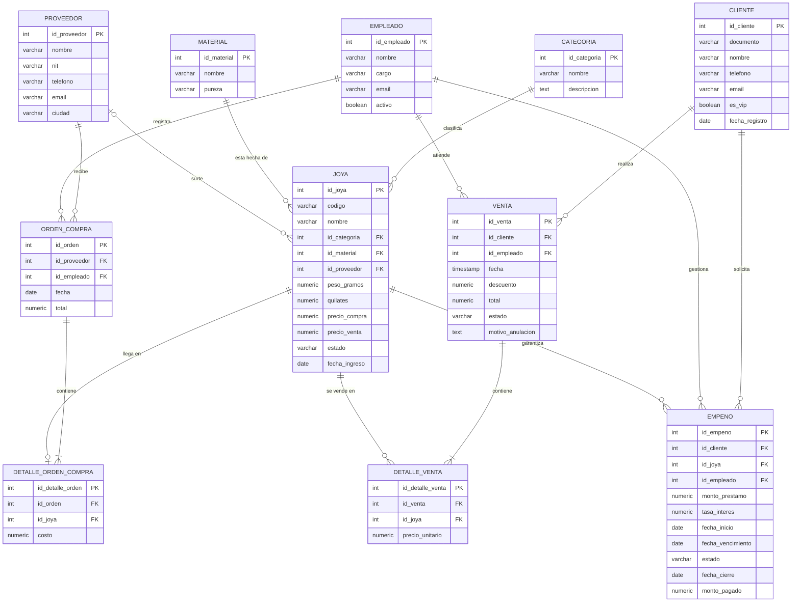

# Diamante en Bruto: Sistema de gestión de joyería

## Descripción
API REST para una casa de joyería que vende piezas a clientes, compra mercancía a
proveedores y otorga préstamos con una joya como garantía. Está pensada
para vendedores y administradores de la tienda, que la usan desde una interfaz web
conectada a una base de datos PostgreSQL.

## Integrantes
Tito Alejandro Burbano Plazas - 20231020169

## Tecnologías
- Python 3.11+ con FastAPI
- PostgreSQL 14+ (acceso con `psycopg` 3 y SQL escrito a mano, sin ORM)
- Interfaz web en HTML + JavaScript, servida por la misma aplicación

## Requisitos previos
| Herramienta | Versión |
|---|---|
| Python | 3.11 o superior |
| PostgreSQL | 14 o superior |
| Git | cualquier versión reciente |
| pgAdmin o DBeaver | opcional, para revisar la base de datos |

## Instalación
1. Clonar el repositorio:
   ```bash
   https://github.com/TitoBurbano/Diamante-en-bruto.git
   cd Diamante-en-bruto
   ```
2. Crear la base de datos y ejecutar los scripts de `/sql` en este orden:
   ```bash
   psql -U postgres -c "CREATE DATABASE joyeria;"
   psql -U postgres -d joyeria -f sql/01_tablas.sql
   psql -U postgres -d joyeria -f sql/02_vistas.sql
   psql -U postgres -d joyeria -f sql/03_datos.sql
   ```
3. Crear el entorno virtual e instalar las dependencias:
   ```bash
   python -m venv .venv
   # Windows:    .venv\Scripts\activate
   # Mac/Linux:  source .venv/bin/activate
   pip install -r requirements.txt
   ```
4. Configurar la conexión: copiar `.env.example` como `.env` y completar los datos
   de tu PostgreSQL (`DB_HOST`, `DB_PORT`, `DB_NAME`, `DB_USER`, `DB_PASSWORD`).
5. Ejecutar la aplicación:
   ```bash
   uvicorn app.main:app --reload
   ```
6. Abrir en el navegador:
   - Interfaz web: http://localhost:8000/
   - Documentación interactiva de la API (Swagger): http://localhost:8000/docs

## Estructura del repositorio
```
sql/        Scripts: 01_tablas.sql, 02_vistas.sql, 03_datos.sql
app/        Código de la API (main.py, db.py, schemas.py, routers/)
static/     Interfaz web
```

## Diagrama ER


## Endpoints

### Sistema
| Método | URL | Descripción | Códigos |
|---|---|---|---|
| GET | `/salud` | Verifica que la API y la base de datos responden | 200 |

### CRUD de entidades
Cada entidad tiene los 5 endpoints: lista, detalle, creación, actualización y eliminación.

| Método | URL | Descripción | Códigos |
|---|---|---|---|
| GET | `/joyas` | Lista las joyas (filtro opcional `?estado=DISPONIBLE`) | 200 |
| GET | `/joyas/{id}` | Retorna una joya por id | 200, 404 |
| POST | `/joyas` | Crea una joya | 201, 422 |
| PUT | `/joyas/{id}` | Actualiza una joya | 200, 404 |
| DELETE | `/joyas/{id}` | Elimina una joya | 204, 404, 409 |
| GET / GET / POST / PUT / DELETE | `/clientes`, `/clientes/{id}` | CRUD de clientes | igual que joyas |
| GET / GET / POST / PUT / DELETE | `/proveedores`, `/proveedores/{id}` | CRUD de proveedores | igual que joyas |
| GET / GET / POST / PUT / DELETE | `/categorias`, `/categorias/{id}` | CRUD de categorías | igual que joyas |
| GET / GET / POST / PUT / DELETE | `/empleados`, `/empleados/{id}` | CRUD de empleados | igual que joyas |
| GET | `/materiales` | Lista los materiales (para los formularios) | 200 |

### Funcionalidades del negocio
| Método | URL | Descripción |
|---|---|---|
| GET | `/ventas` | Lista las ventas |
| GET | `/ventas/{id}` | Retorna una venta con su detalle |
| POST | `/ventas` | Registra una venta (funcionalidad 1) |
| POST | `/ventas/{id}/anular` | Anula una venta (funcionalidad 5) |
| GET | `/ordenes-compra` | Lista las órdenes de compra |
| POST | `/ordenes-compra` | Registra la recepción de mercancía de un proveedor (funcionalidad 2) |
| GET | `/empenos` | Lista los empeños |
| POST | `/empenos` | Registra un empeño (funcionalidad 3) |
| POST | `/empenos/{id}/saldar` | Salda un empeño (funcionalidad 4) |
| POST | `/empenos/{id}/vencer` | Marca un empeño como vencido (funcionalidad 6) |

### Reportes (vistas y subconsultas)
| Método | URL | Descripción |
|---|---|---|
| GET | `/reportes/inventario` | Joyas disponibles con categoría, material y proveedor (usa `vista_inventario_disponible`) |
| GET | `/reportes/empenos-activos` | Empeños activos con cliente, joya y días para vencer (usa `vista_empenos_activos`) |
| GET | `/reportes/joyas-sobre-promedio` | Joyas disponibles con precio de venta mayor al promedio (subconsulta en `WHERE`) |
| GET | `/reportes/clientes-sin-compras` | Clientes que nunca han comprado (subconsulta con `NOT EXISTS`) |

## Requerimientos funcionales

| # | Funcionalidad | Qué hace | Endpoint | Tablas que modifica | Tablas que consulta |
|---|---|---|---|---|---|
| 1 | Registrar venta | Valida que todas las joyas estén `DISPONIBLE`, las marca como `VENDIDA`, calcula el total, aplica 10 % de descuento si el cliente es VIP y guarda el detalle. Si una joya falla, no se guarda nada (transacción). | `POST /ventas` | `venta`, `detalle_venta`, `joya` | `cliente`, `empleado`, `joya` |
| 2 | Recibir mercancía de un proveedor | Registra una orden de compra y crea en el inventario cada joya recibida con su costo, su precio de venta y su estado `DISPONIBLE`. Todo en una sola transacción. | `POST /ordenes-compra` | `orden_compra`, `detalle_orden_compra`, `joya` | `proveedor`, `empleado`, `categoria`, `material` |
| 3 | Registrar empeño | Registra la joya que deja el cliente en garantía (estado `EMPENADA`) y el préstamo. El monto no puede superar el 60 % del precio de venta de la joya y el vencimiento debe ser posterior a hoy. | `POST /empenos` | `empeno`, `joya` | `cliente`, `empleado`, `categoria`, `material` |
| 4 | Saldar empeño | Calcula el valor a pagar (capital más interés mensual proporcional a los meses transcurridos, mínimo uno), registra el pago, cierra el empeño y marca la joya como `DEVUELTA`. | `POST /empenos/{id}/saldar` | `empeno`, `joya` | `empeno`, `joya` |
| 5 | Anular venta | Exige un motivo, marca la venta como `ANULADA` y devuelve sus joyas a `DISPONIBLE`. Rechaza ventas ya anuladas. | `POST /ventas/{id}/anular` | `venta`, `joya` | `detalle_venta` |
| 6 | Vencer empeño | Si el empeño está activo y ya pasó su fecha de vencimiento, lo marca `VENCIDO` y la joya pasa a `DISPONIBLE` para venderse. | `POST /empenos/{id}/vencer` | `empeno`, `joya` | `empeno`, `joya` |

Los errores de negocio (joya no disponible, empeño ya cerrado, etc.) se devuelven con
código HTTP 409 y un mensaje claro, que la interfaz muestra al usuario.